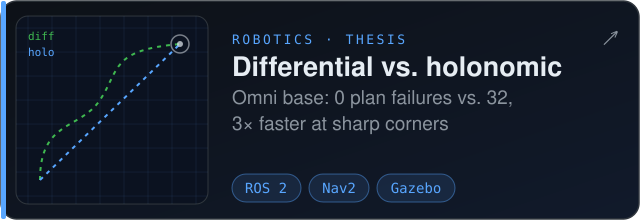
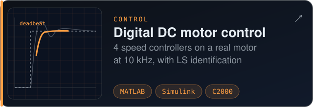
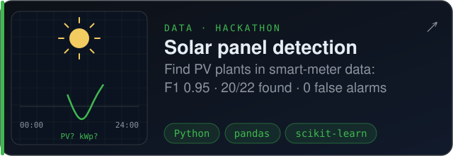
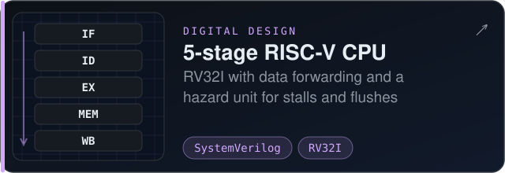
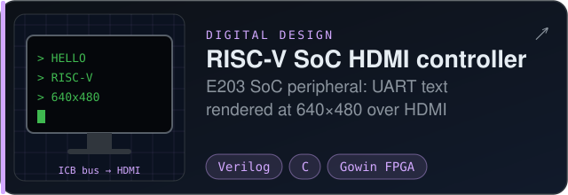
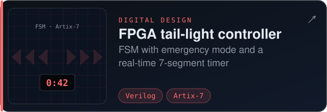
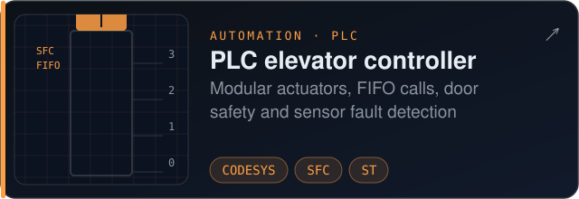
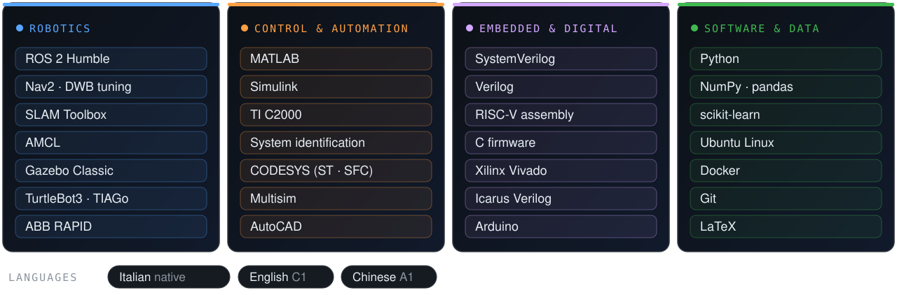

I like understanding autonomous systems **end to end**: how a robot plans its path, how its motors are controlled, and how the processor underneath executes it all. Below are the projects I've built along the way.

Side quests: <a href="https://github.com/andreagallo-dev/a-2009-server-odyssey">a self-hosted home server on 2009 hardware</a> · <a href="https://github.com/andreagallo-dev/Cinnamon_Linux-rice">my first Linux rice</a>

### Toolbox

### Next

🎯 Applying for an **MSc in Robotics** to specialise in **motion planning and autonomous navigation**. Open to internships and entry-level roles in robotics and embedded systems.

Off the keyboard: Taekwondo, 1st Dan black belt after ten years of training.
